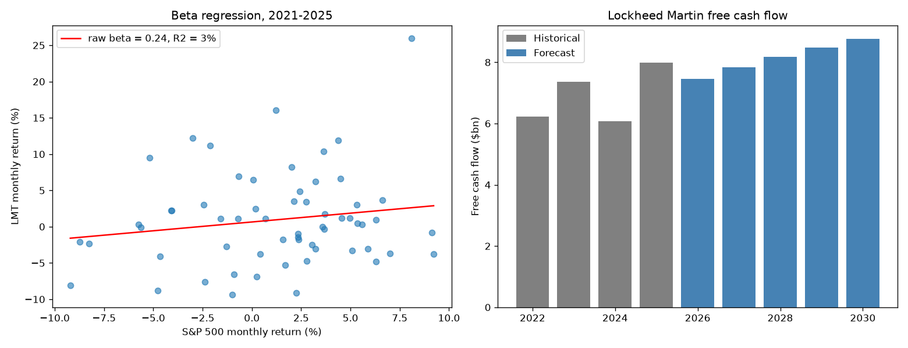

# Lockheed Martin DCF

Personal project: a discounted cash flow valuation of Lockheed Martin (NYSE: LMT), built from its 10-K filings, in Python.

My [first DCF](https://github.com/louischarpentier83-source/dcf-valuation-model) used a fictional company and an assumed beta. This one applies the same method to a real company: the historical figures come from five years of 10-K filings, the beta is estimated with a linear regression, and the forecast assumptions are anchored on the company's own history. I chose the defense sector, and Lockheed Martin because its 10-K is available as structured data from the SEC.

[](https://colab.research.google.com/github/louischarpentier83-source/lockheed-martin-dcf/blob/main/LMT_DCF.ipynb)



## Data

| Data | Source | File |
|---|---|---|
| Income statement, cash flow and balance sheet, 2021-2025 | 10-K filings, SEC EDGAR API | `data/lmt_10k.csv` |
| Monthly prices of LMT and of the S&P 500 total return index, Dec 2020 - Dec 2025 | Yahoo Finance | `data/monthly_prices.csv` |
| 10-year US Treasury yield at 31/12/2025 (4.18%) | FRED, series DGS10 | input in the notebook |

`get_data.py` downloaded these files. The notebook only reads the CSV files, so the results do not change when new data is published.

The valuation date is **31 December 2025**, the date of the last 10-K balance sheet. The risk-free rate, the beta and the share price ($483.67) are all taken at that date.

## What the notebook does

1. Data
2. Inputs
3. Historical analysis: growth, margins, tax rate, D&A, CapEx and working capital as % of revenue
4. Beta: linear regression of LMT returns on S&P 500 returns
5. Cost of capital (WACC)
6. Free cash flow forecast, 2026-2030
7. Terminal value
8. Discounting and enterprise value
9. Enterprise value to share price
10. Sensitivity analysis
11. Charts

## Formulas

```
Beta (regression)  = Covariance(LMT, S&P 500) / Variance(S&P 500)     [60 monthly returns]
Adjusted beta      = 0.67 x Raw beta + 0.33 x 1                        [Blume]
Cost of equity     = Risk-free rate + Adjusted beta x Market premium   [CAPM]
Cost of debt       = Risk-free rate + Credit spread
WACC               = We x Cost of equity + Wd x Cost of debt x (1 - t)

NWC                = Receivables + Contract assets + Inventories - Payables - Contract liabilities
NOPAT              = EBIT x (1 - tax rate)
FCF                = NOPAT + D&A - CapEx - Change in NWC

Terminal RONIC     = WACC + 2 points
Terminal FCF       = NOPAT 2030 x (1 + g) x (1 - g / RONIC)
Terminal value     = Terminal FCF / (WACC - g)                         [Gordon Growth]
Enterprise value   = sum of PV(FCF) + PV(Terminal value)               [mid-year discounting]
Equity value       = Enterprise value - Debt + Cash - Pension deficit
Price per share    = Equity value / Shares outstanding
```

## Choices I had to make

**Beta.** The regression gives a raw beta of 0.24 with an R squared of only 2.6%: the S&P 500 explains almost none of LMT's monthly moves. Defense revenue depends on government budgets, not on the economic cycle, so the stock moves on its own news. A beta this imprecise cannot be used as it is. I apply the Blume adjustment (the one Bloomberg uses), which moves it to 0.49. The regression is also checked with `np.polyfit`, which gives the same slope.

**Forecast assumptions.** EBIT margin, tax rate, D&A and CapEx are the 2021-2025 averages from the 10-K. The average EBIT margin (11.8%) is above the 2024 and 2025 margins (9.9% and 10.3%), so the base case assumes margins recover; the second sensitivity table shows what happens if they do not. Working capital is kept at its 2025 level (7.1% of revenue) and not at the 9.6% average, because going back to the average would create a $2bn cash outflow in 2026 that nothing in the 10-K supports. Revenue growth (5% in 2026, falling to 3% in 2030) is my own assumption: slightly above the 2.9% average of 2022-2025, which had one year of decline, and in line with the last two years (5.1% and 5.6%).

**Working capital.** For a defense contractor, most of the working capital is contract balances: work done but not yet billed (contract assets) and advances received from the government (contract liabilities). I include both, otherwise the NWC would miss most of what moves the cash.

**Equity bridge.** The pension deficit ($3.9bn) is deducted like debt, before tax. Operating lease liabilities are not deducted: under US GAAP the lease payments are already in EBIT, so deducting them would count them twice. All the cash is treated as excess cash.

**Terminal value.** Same logic as in my first project: reinvestment is derived from g / RONIC with RONIC = WACC + 2 points (McKinsey's *Valuation*).

## Results

| | |
|---|---|
| Raw beta / adjusted beta | 0.24 / 0.49 |
| Cost of equity | 6.40% |
| WACC | 6.07% |
| Enterprise value | $163.8bn |
| Terminal value as % of EV | 78.6% |
| Implied share price | $621 |
| Share price at 31/12/2025 | $484 |
| Upside | +28.5% |

Across a +/-100bp WACC band and a 1% to 3% terminal growth band, the implied price ranges from $477 to $958. At a WACC of 7.07% (+100bp) and g of 2%, the price is $502, close to the market price. In other words, the market price at the end of 2025 is consistent with a cost of capital about one point higher than the one this model derives, which is what you would get with a beta of about 0.75.

The second table crosses the EBIT margin (9% to 14%) with a shift of -2 to +2 points in yearly revenue growth. With the 2024-2025 margins (around 10%) the price falls to about $511, almost the market price. Most of the upside comes from the two assumptions I was least sure about: a low beta and a margin recovery.

## Running it

Click the Colab badge to open the notebook in a browser, or run it locally:

```bash
pip install -r requirements.txt
jupyter notebook LMT_DCF.ipynb
```

All the inputs are in section 2. To download the data again: `python get_data.py`.

## What I would improve

- The beta is the weakest input. A bottom-up beta (the average unlevered beta of defense peers such as Northrop Grumman, General Dynamics and RTX, relevered at LMT's debt ratio) would be more reliable than a regression with an R squared of 3%.
- The revenue forecast does not use the order backlog, which is the best indicator of future revenue for a defense company.
- The pension deficit is deducted before tax; the contributions that fund it are tax-deductible, so an after-tax figure would be slightly lower.
- The terminal value is about 79% of the enterprise value, so the result depends a lot on the perpetual growth rate and the WACC.

## Disclaimer

This is a student project built to practise valuation. It is not investment advice.

## Author

Louis Charpentier - [LinkedIn](https://www.linkedin.com/in/lchrpt/)
